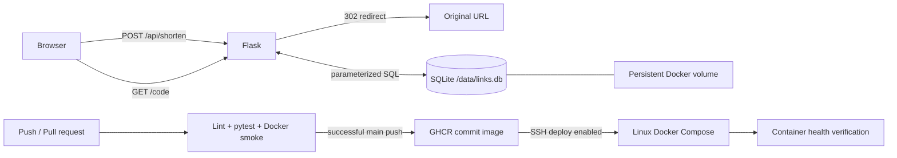

# Automated CI/CD Pipeline for a Dockerized URL Shortener Service Using GitHub Actions and Docker

**DevOps Lab CA** · Anas Shaikh (16010123265), Saad Waghoo (16010123285), Ruhan Naik (16010123279)

A small Flask application turns HTTP(S) URLs into seven-character links, redirects visitors, and records clicks in SQLite. The homepage uses HTML, CSS, and vanilla JavaScript. GitHub Actions tests the code, checks a container, publishes images to GHCR, and optionally deploys a specific commit to an existing Linux Docker host.

## Architecture



The browser follows redirects; the server never fetches destination content. SQLite is appropriate for a small single-host project, not multiple hosts sharing one database. A deployment replaces the container while keeping the named volume. Publishing an image is separate from deploying it.

## Project structure

```text
app.py / wsgi.py         Flask application factory / Gunicorn entrypoint
templates/ / static/    Responsive frontend
tests/                  Isolated pytest databases and behavior tests
scripts/smoke.py         Real HTTP end-to-end check
Dockerfile              Non-root Linux runtime with health check
compose.yaml            Local container and database volume
deploy/                 Production Compose and deployment script
.github/workflows/      CI, GHCR publishing, optional SSH CD
docs/                   Report, demo, viva, evidence and contribution guides
```

## Prerequisites

Windows: Python 3.12, Git, and Docker Desktop with Linux containers. Start Docker Desktop from the Start menu and wait for its engine to be ready. GitHub is needed only for hosted CI and GHCR. A Linux server with Docker Engine, Compose v2 supporting `--wait`, SSH, and `flock` is needed for live CD. No infrastructure is provisioned by this project.

## Run with Python — Windows PowerShell

Open this folder in Codex or VS Code and open **Terminal → New Terminal** (PowerShell):

```powershell
py -3.12 -m venv .venv
.\.venv\Scripts\python.exe -m pip install -r requirements-dev.txt
$env:PUBLIC_BASE_URL = 'http://localhost:8000'
.\.venv\Scripts\python.exe -m flask --app wsgi run --port 8000
```

Open [localhost:8000](http://localhost:8000). Leave that terminal running. In a second PowerShell terminal:

```powershell
.\.venv\Scripts\ruff.exe check .
.\.venv\Scripts\python.exe -m pytest -q
.\.venv\Scripts\python.exe scripts/smoke.py
```

Stop the local server with Ctrl+C. Flask's development server is for local demonstrations; the Docker image runs Gunicorn. Flask CLI does not automatically load `.env` here; set PowerShell environment variables explicitly. Compose loads `.env` automatically.

For a local demo independent of the terminal session, run `.\scripts\start-local.ps1` in PowerShell. It starts a hidden Python server on port 8001, using local `data/links.db`. Open http://127.0.0.1:8001. Logs and the process ID are written under `data/`. This is a local alternative when Docker is unavailable; its database is separate from the Docker volume. It must be started again after restarting Windows.

## Configuration

| Setting | Default | Purpose |
|---|---|---|
| `PUBLIC_BASE_URL` | `http://localhost:8000` | Base of links returned to users; use the externally reachable URL on deployment |
| `DATABASE` | `data/links.db` outside Docker | SQLite location; Docker sets `/data/links.db` |
| `PORT` | `8000` | Compose host port |
| `IMAGE` | required in production | Commit-specific GHCR image |

Set a base URL without a path prefix or trailing slash. Avoid credentials in it. `.env.example` is safe to copy; actual `.env`, database files, private keys and virtual environments are ignored. Runtime and development dependencies are pinned directly for reproducible student setup. Transitive dependencies and the Python base image can still receive updates; this is not a fully locked supply chain. Python 3.12 is the consistent local/CI/container target.

## API examples — Windows PowerShell

```powershell
$body = @{ url = 'https://example.com/course?unit=devops' } | ConvertTo-Json
$link = Invoke-RestMethod -Method Post -Uri 'http://localhost:8000/api/shorten' -ContentType 'application/json' -Body $body
$link
curl.exe -i $link.short_url
Invoke-RestMethod "http://localhost:8000/api/stats/$($link.short_code)"
Invoke-RestMethod 'http://localhost:8000/health'
```

`POST /api/shorten` returns 201 with `short_code` and `short_url`. `GET /<code>` returns 302 and increments clicks. Stats return `short_code`, `original_url`, UTC `created_at`, and `clicks`. Unknown codes return JSON 404. Invalid/missing URLs return JSON 400; oversized bodies return 413; exhausted collision retries return 503. Only HTTP(S) addresses with a hostname and valid port are accepted. Credentials, whitespace, control characters, backslashes and URLs longer than 2048 characters are rejected. The service does not check whether a destination actually exists.

## Docker — Windows PowerShell

```powershell
Copy-Item .env.example .env
docker compose config
docker compose build
docker compose up -d --wait
docker compose ps
docker compose logs --tail 100 web
.\.venv\Scripts\python.exe scripts/smoke.py
```

Database permission handling: `/data` is owned by UID/GID 10001 in the image. A new named volume inherits that directory's ownership. The app runs as that non-root user. Use the supplied named volume, not an arbitrary Windows bind mount.

### Prove persistence across container recreation

```powershell
$body = @{ url = 'https://example.com/persistent' } | ConvertTo-Json
$saved = Invoke-RestMethod -Method Post -Uri 'http://localhost:8000/api/shorten' -ContentType 'application/json' -Body $body
curl.exe -s -o NUL $saved.short_url
Invoke-RestMethod "http://localhost:8000/api/stats/$($saved.short_code)"
docker compose down
docker compose up -d --wait
Invoke-RestMethod "http://localhost:8000/api/stats/$($saved.short_code)"
```

The same record and click count must remain. `docker compose down` retains the volume; **`docker compose down -v` deletes it**. Avoid `-v` unless intentionally cleaning up all stored links. For an additional restart check use `docker compose restart web`.

To automate the smoke and recreation checks, run `.\scripts\verify-container.ps1` from this folder's PowerShell terminal. This removes and recreates only this project's container/network, retains the named volume, and leaves the service running. Pass `-BaseUrl http://localhost:8001` if you changed the port.

## GitHub setup — browser and Windows PowerShell

1. On GitHub click **+ → New repository**. Choose a name such as `devops-url-shortener`. Create an empty repository without a generated README.
2. In this folder's PowerShell terminal, replace `YOUR-USERNAME` and repository name:

   ```powershell
   git add .
   git commit -m "Build Dockerized URL shortener with CI/CD"
   git branch -M main
   git remote add origin https://github.com/YOUR-USERNAME/devops-url-shortener.git
   git push -u origin main
   ```

   Git is already initialized. If `origin` exists, inspect `git remote -v` and use `git remote set-url origin URL` only if appropriate. Authenticate through Git's browser prompt. Inspect `git diff --cached` before committing; never add secrets.
3. Open the repository's **Actions** tab and select **Test, publish and deploy**. The `ci` job installs dependencies, lints, tests, builds the image, starts it and runs a real API smoke test. Pull requests run only CI and have no deployment secrets. The publish job runs only after successful CI on a push to `main`.
4. The publish job authenticates to GHCR with `GITHUB_TOKEN` and publishes lowercase `ghcr.io/owner/repository:COMMIT_SHA`, `:main` and `:latest`. Commit tags support rollback; main/latest are moving tags. The publish job rebuilds the same tested source; the pipeline does not promise bit-identical images between builds.
5. If publishing fails with a permissions error, check **Settings → Actions → General → Workflow permissions** and organization policy. The workflow requests package write permission only in the publishing job. Existing packages may also need this repository granted access in package settings.
6. Find the package on your GitHub profile under **Packages**. For the easiest lab deployment, open the package **Settings → Danger Zone → Change visibility → Public** if you intend the source/image to be public. Private images require a separate read-only registry login on the server; `GITHUB_TOKEN` is used for publishing, not persisted remotely.

The workflow uses supported [checkout](https://github.com/actions/checkout) and [setup-python](https://github.com/actions/setup-python) action versions. The volume design follows [Docker's volume documentation](https://docs.docker.com/engine/storage/volumes/).

## Prepare an existing deployment host — Linux SSH terminal

Use an existing authorized Linux machine; the workflow does not buy or create a server. Install Docker Engine and the Compose plugin following [Docker's official instructions](https://docs.docker.com/engine/install/). Ensure the chosen SSH user can run Docker without an interactive sudo prompt. Docker group membership gives broad host control; use a dedicated deployment user on a lab host.

```bash
sudo mkdir -p /opt/url-shortener
sudo chown "$USER:$USER" /opt/url-shortener
cd /opt/url-shortener
cat > .env <<'EOF'
PUBLIC_BASE_URL=http://YOUR-HOST:8000
PORT=8000
EOF
chmod 600 .env
docker version
docker compose version
command -v flock
```

Replace YOUR-HOST with a browser-reachable IP/domain. Allow TCP port 8000 only where appropriate for the demo, or put an HTTPS reverse proxy in front and set its public URL. For private GHCR packages, create a GitHub classic PAT with `read:packages`, log in **on the Linux host** using `docker login ghcr.io -u YOUR-USERNAME --password-stdin`, and supply the token through stdin without putting it in Git or workflow logs. The SSH user must own this Docker login.

Create a dedicated SSH key in Windows PowerShell (choose a unique unused filename):

```powershell
ssh-keygen -t ed25519 -f "$env:USERPROFILE\.ssh\devops_lab_deploy" -C 'devops-lab-deploy'
Get-Content "$env:USERPROFILE\.ssh\devops_lab_deploy.pub"
```

Install the public key in the deployment user's `~/.ssh/authorized_keys` on Linux; directory permissions 700, file permissions 600. For unattended Actions use a dedicated key without a passphrase, protect it as a repository environment secret, and revoke it after the lab. Do not paste the private key into chat or source files.

### Verify SSH host identity

On the trusted Linux host console run `sudo ssh-keygen -lf /etc/ssh/ssh_host_ed25519_key.pub`. On Windows run `ssh-keyscan -t ed25519 YOUR-HOST` (add `-p PORT` for a custom port), save the output to a temporary file, then run `ssh-keygen -lf FILE`. Compare fingerprints through the trusted console or administrator. **Scanning alone does not verify identity.** Only put the matching known-host line into GitHub. A custom port line must use `[host]:port` syntax. Strict host-key checking remains enabled.

### Configure GitHub CD — browser

Open **Repository → Settings → Environments → New environment**, name it `production`. Configure these environment secrets and variables (or use repository-level values at **Settings → Secrets and variables → Actions**):

| Name | Type | Value / purpose |
|---|---|---|
| `DEPLOY_SSH_KEY` | Secret | Complete dedicated private key; used only for SSH |
| `DEPLOY_KNOWN_HOSTS` | Secret | Verified known_hosts entry for the exact host/port |
| `DEPLOY_HOST` | Variable | Hostname or IPv4 address, without scheme |
| `DEPLOY_USER` | Variable | Dedicated Linux SSH username |
| `DEPLOY_PORT` | Variable | SSH port, defaults to 22 |
| `DEPLOY_ENABLED` | **Repository variable** | `true` only after the host is ready; job conditions cannot read environment-only variables before entering the environment |

`PUBLIC_BASE_URL` and application port live in the host's `.env`; `IMAGE` is injected by deployment. Configure optional environment protection/reviewers in `production` if supported by your GitHub plan. Push a new commit to main to deploy. The workflow copies production files into `/opt/url-shortener`, pulls the exact commit image and runs Compose `up --wait`. GitHub concurrency and a host `flock` prevent overlapping deployments. Deployment failures return a nonzero exit code and print container logs. It preserves the database volume but can briefly interrupt the service. Health verifies the application and database inside the container; also open the public URL to verify firewall/DNS/proxy access.

## Rollback — Linux SSH terminal

```bash
cd /opt/url-shortener
cat previous-image.txt
bash deploy.sh "$(cat previous-image.txt)"
```

Alternatively pass a known previous full commit tag. Keep previous GHCR images available. Rollback keeps current database records; this project uses one stable schema and makes no schema migrations. Before future schema changes, take a database backup and design compatibility. The deployment script records the previous running image before replacement and the current image only after health succeeds. It does not roll back automatically.

## Troubleshooting and cleanup

- Docker named-pipe error: start Docker Desktop, wait for the engine, use Linux containers, then `docker version`.
- Port occupied: stop the local Flask process or set `PORT=8001` and `PUBLIC_BASE_URL=http://localhost:8001` in `.env`.
- Wrong generated host: fix `PUBLIC_BASE_URL` and recreate the container with `docker compose up -d`.
- Database permission errors: use the named volume; do not chmod databases world-writable. Existing volumes created by another UID require ownership repair by the host administrator.
- SSH error: check host/user/port, authorized key, exact verified host key, and host directory permissions.
- GHCR unauthorized: make the package public or configure the server's read-only registry login.
- Deploy unhealthy: SSH to the host, run `docker compose logs --tail 100 web` with `IMAGE` exported from `current-image.txt` or the attempted tag, then fix or roll back.
- Stop locally with `docker compose down`; stop on Linux using `IMAGE="$(cat current-image.txt)" docker compose down`. Add `-v` only when deliberately deleting the database. Revoke deployment keys/tokens after submission.

## Submission and validation

See [report](docs/report.md), [demo guide](docs/demo-guide.md), [viva questions](docs/viva-questions.md), [evidence checklist](docs/evidence-checklist.md), [proposed contributions](docs/team-contributions.md), and [actual validation results](docs/validation.md).

This is a teaching project without authentication, abuse prevention, expiration, rate limiting, TLS termination, high availability, or distributed storage. Avoid exposing an unrestricted public instance for ongoing use. No live GitHub publishing or deployment is claimed until real runs are captured.
