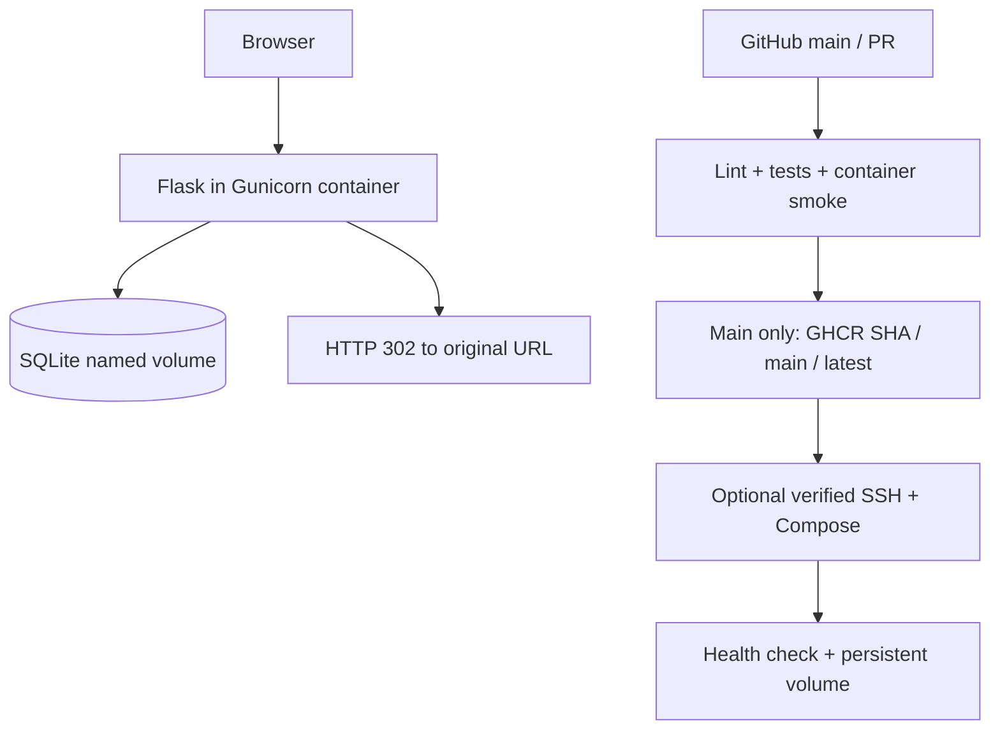

# DevOps Lab CA Report

## Title and team
Automated CI/CD Pipeline for a Dockerized URL Shortener Service Using GitHub Actions and Docker

Anas Shaikh — 16010123265; Saad Waghoo — 16010123285; Ruhan Naik — 16010123279.

## Abstract
This project demonstrates an automated delivery process for a small URL shortener. Flask provides an HTTP API and serves a responsive frontend. SQLite stores destinations and click counts. Docker packages the service, and GitHub Actions runs checks before publishing an image. Optional SSH deployment updates a Linux Compose service and checks its health. Persistent storage is separated from the container lifecycle.

## Problem statement
Manual testing and deployment can introduce errors and inconsistent environments. A compact application is needed to demonstrate how development, testing, containerization, integration and deployment connect in a reproducible workflow.

## Objectives
- Build an understandable HTTP(S) URL shortener with redirects and statistics.
- Validate input and use parameterized SQL with collision-safe insertion.
- Automate tests and linting in isolated environments.
- Run as a non-root container with durable database storage.
- Publish versioned images and provide verified SSH deployment and rollback.
- Collect real evidence rather than assume remote stages succeeded.

## Tools
Python 3.12, Flask, SQLite, HTML/CSS/JavaScript, pytest, Ruff, Gunicorn, Docker, Docker Compose, Git, GitHub Actions, GHCR and OpenSSH. Gunicorn is the production WSGI server inside Linux containers; Flask's development server supports the local Windows demonstration.

## Architecture

## Implementation
The application factory accepts configuration from environment variables or tests. A links table stores a unique short code, destination, UTC timestamp and click counter. Seven random alphanumeric characters are generated using Python's secrets module. A primary-key constraint detects collisions; insertion retries at most ten times. Database parameters are bound separately from SQL. Redirect requests atomically increment the counter and return a non-cacheable 302 without contacting the destination. Health checks query the database.

The frontend submits JSON through fetch, shows validation/network failures, displays the generated link, and copies it with the Clipboard API where supported. Text is displayed using textContent. CSS adapts the layout for small screens.

Docker uses a Python slim image, pinned direct dependencies and UID 10001. Gunicorn runs two workers. SQLite WAL mode and a connection timeout support modest local concurrency. The database directory is owned by the app user; Compose mounts a named volume there.

## Testing
Pytest uses temporary databases for creation, redirect headers, invalid/missing inputs, unknown codes, click increments, health, frontend resources, collisions, exhausted retries, persistence across app instances, SQL parameterization and oversized bodies. A standard-library HTTP smoke script checks a running service without fetching the redirect destination. Docker persistence must additionally be tested by container recreation. Actual executed results are maintained in `docs/validation.md`; GitHub and deployment evidence must come from genuine runs.

## CI/CD stages
1. Main pushes and pull requests run lint, tests, Docker build and container smoke checks.
2. A successful main push enables a separate package-write job. It authenticates with GITHUB_TOKEN and pushes lowercase GHCR image paths with SHA, main and latest tags.
3. When repository variable DEPLOY_ENABLED is true, a production environment job uses a dedicated SSH key and verified known_hosts.
4. The host pulls the commit image, updates Compose and waits for health while preserving the database volume. GitHub concurrency and host locking serialize deployments.
5. Failure logs explain health/deployment errors. A recorded prior image supports manual rollback.

## Results
Source code, tests, container configuration, automation and documentation are implemented. Refer to the dated validation record for actual local checks. **Remote CI, GHCR publishing and live CD require repository/host setup and are not inferred from local success.** Add real run links and screenshots from the evidence checklist before submission.

## Limitations
The service is intended for a college demonstration on one host. SQLite is not a distributed database. Deployment can briefly interrupt availability. There is no login, rate limiting, abuse detection, URL expiry, HTTPS proxy, automatic rollback or migration framework. Direct dependencies are pinned, but transitive dependencies/base images are not immutable. Copying can require HTTPS or localhost; a manual fallback is provided.

## Conclusion
The project connects application behavior with automated verification, reproducible container execution, image delivery and health-checked deployment. It demonstrates the difference between continuous integration, publishing an artifact, and deploying that artifact to a running service. Persistent storage and commit-specific tags support safe recreation and practical rollback.
